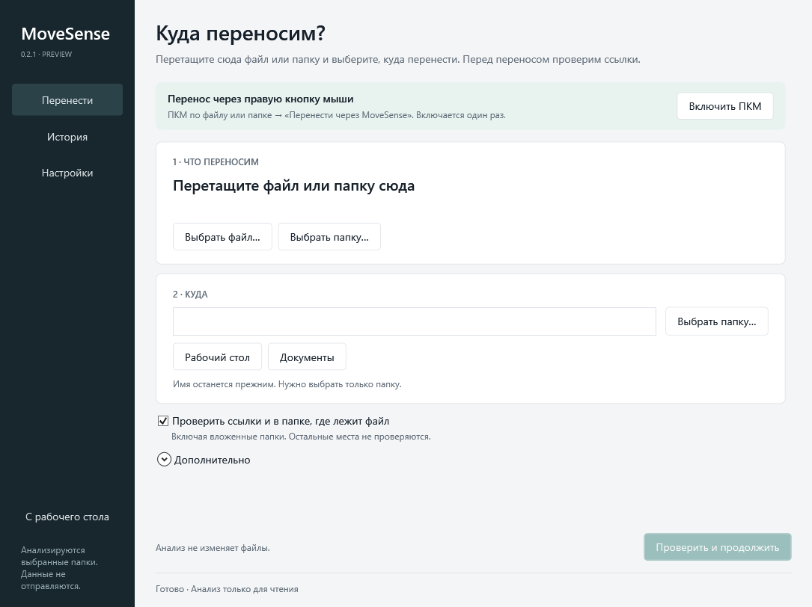

# MoveSense

Move files and folders without losing track of the links that point to them.

MoveSense checks local references, previews Markdown and JSON path repairs,
and keeps a journal so a move can be undone.

[Download](https://github.com/DOPIAS/MoveSense/releases) · [По-русски](README.ru.md)



## Use it

1. Extract the portable ZIP and open `MoveSense.exe`.
2. Drop a file or folder into the window and choose a destination folder.
3. Review the affected links, then click **Move here**.

**Put it back** undoes the last move. Older operations are available in History.
The containing folder is checked by default; its path is shown and can be
excluded. Add other locations or change the item name under **More options**.

### From the desktop or Explorer

Click **Enable right-click menu** once. You can then right-click a file or
folder and choose **Move with MoveSense**. On Windows 11, use **Show more
options**. The destination picker opens immediately.

Settings can also create a desktop shortcut. Drop a file or folder onto the
shortcut to start a move. If you relocate the portable app, use **Update menu**
in the new copy. Both integrations apply to the current Windows account.

## What it checks

| Format | Detection | Automatic repair |
| --- | --- | --- |
| Markdown | Links, images and reference definitions | Yes |
| JSON / JSONC | Local paths in string values | Yes |
| Project XML | Selected Include, Update, Project and HintPath values | No |
| XML / INI / TOML / YAML | Selected quoted path values | No |
| Windows shortcuts | Target and working directory | No |

For example, moving `assets/` into `archive/` changes a link in `README.md`
from `assets/layout.svg` to `archive/assets/layout.svg`. A link from
`assets/notes.md` to `../README.md` becomes `../../README.md`.

[Dark theme](docs/images/dark.png) · [Settings](docs/images/settings.png)

## Limits

This is a preview for Windows x64. The portable build includes .NET; no separate
runtime installation is needed. Builds are not code-signed. The interface is
available in English and Russian.

Moves must stay on the same drive. Existing destinations, network shares,
symbolic links and junctions are rejected. Files are checked again before a
move or recovery; newer edits and added files prevent undo.

Only selected syntax and locations are analyzed. Application databases,
scripts and references outside the scan scope may still break. Review-only
references and incomplete scans require acknowledgment.

The journal backs up repaired documents, not the moved data. Keep independent
backups. [Coverage and recovery details](docs/safety.md).

## Build

Requires Windows and the .NET 8 SDK.

```powershell
dotnet build
dotnet test
dotnet run --project src/MoveSense.Desktop
```

Create a self-contained portable ZIP with:

```powershell
./scripts/build.ps1
```

Add `-Installer` with Inno Setup 6 installed to build a per-user installer.
Outputs go to `artifacts/`. The app stores settings and history in
`%LOCALAPPDATA%\MoveSense`.

The UI uses WPF. The core has no third-party runtime packages; the history index
uses Windows' built-in SQLite. See [CONTRIBUTING.md](CONTRIBUTING.md) for testing
and [release instructions](docs/releases.md) for packaging.

## License

[MIT](LICENSE). Portable packages include the redistributed .NET runtime notices.
